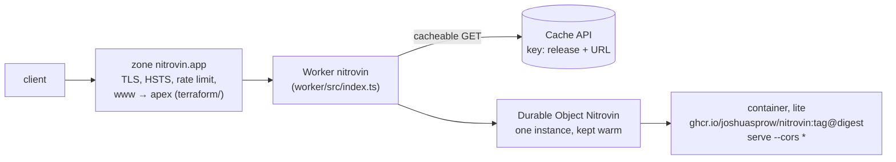

# nitrovin.app on Cloudflare

`https://nitrovin.app` runs the released image's `nitrovin serve`: the decode
form at `/`, the `/v1` API and MCP over Streamable HTTP at `/mcp`
([#104](https://github.com/joshuasprow/nitrovin/issues/104)).



| Piece | Where | Applied by |
| --- | --- | --- |
| Worker, Durable Object, container, keep-warm cron | `worker/` (`wrangler.jsonc`, `src/index.ts`, `Dockerfile`) | `wrangler deploy` in `deploy.yml` |
| Zone settings (Full strict, always HTTPS, TLS ≥ 1.2, HSTS), the custom domain, `www` and its redirect, the rate limit | `terraform/` | `terraform apply` in `deploy.yml` |
| The CI token, the state bucket | `terraform/token/` | a person, at bootstrap |

- **Image.** Containers cannot pull from ghcr.io, so `worker/Dockerfile` is
  `FROM ghcr.io/joshuasprow/nitrovin:<tag>@<digest>` plus the command, and
  `wrangler deploy` pushes it to Cloudflare's registry. `deploy.yml` rewrites
  the `FROM` line to the release it deploys after `cosign verify` proves the
  digest is the one that tag's `release.yml` signed.
- **Container.** The `default` scheduling policy, `lite` (1/16 vCPU,
  256 MiB), `max_instances: 3`. Every request goes to one named instance;
  a cron fetches `/healthz` every four minutes, inside `sleepAfter`'s ten,
  so it never sleeps. Readiness is `/healthz`: `serve` listens only once the
  data has loaded.
- **Cache.** `GET /v1/decode/*`, `GET /v1/info` and `GET /?…` are served
  from the Cache API when the container answered 200, under a key of the
  release (`decoder_version`, `data_month`, `artifact_hash` from `/v1/info`,
  read every 30 s) and the URL: a new data month is a new key, never last
  month's answer. They carry `Cache-Control: public, max-age=86400` and
  `Cf-Cache-Status` (`MISS`, `HIT`, `BYPASS`). Everything else, refusals
  included, is `no-store`; `POST` and `/mcp` never touch the cache.
- **CORS** is the container's (`serve --cors '*'`): `/v1` and `/mcp` only.
- **Logs.** Workers Logs without invocation logs, which would record each
  URL and so each VIN. The Worker logs nothing itself.
- **Rate limit.** `/v1/decode*` and `/mcp`: 100 requests per 10 s per IP,
  then 10 s refused. The Free plan's one rule.

Cost: Workers Paid $5 a month, one warm `lite` about $1.70; three instances
at most bound it near $12.

## Deploy, roll back

Every green release (`release.yml` on a `v*` tag) deploys itself:
`deploy.yml` resolves and verifies the image, `wrangler deploy`s it, applies
Terraform when its plan has changes (copying the state to
`history/main/` in the bucket first: R2 keeps no object versions), and runs
`smoke.sh` against `https://nitrovin.app`, whose output is the run's summary.
Runs are serialized.

```sh
gh workflow run deploy.yml -R joshuasprow/nitrovin -f tag=v0.1.6   # deploy (or redeploy) a release
gh workflow run deploy.yml -R joshuasprow/nitrovin -f tag=<previous tag>   # roll back, container included
cd deploy/cloudflare/worker && npx wrangler rollback               # roll back the Worker version alone
```

A weekly `drift` job fails when `terraform plan` is not empty.

## Develop

```sh
cd deploy/cloudflare/worker && npm ci && npm run check   # types
deploy/cloudflare/worker/dev-test.sh                     # wrangler dev on this tree's container
```

`dev-test.sh` needs Docker and Go, no account: it builds two images of this
tree that differ only in `decoder_version` and serves them in turn under
`wrangler dev` with one persisted cache, running `smoke.sh` against each. A
decode is a `MISS`, then a `HIT`; the second image's first decode of the
same URL is a `MISS` again (the release is in the key), and the first
image's, run again, a `HIT` (the cache did persist). Pull requests touching
`deploy/cloudflare` run it, with Terraform's `validate` (and `plan` once
the secrets exist).

## Bootstrap (once, by hand)

On the Cloudflare account that holds `nitrovin.app` (Josh's own; not the
company's). Secrets go into the repository with `op read … | gh secret set`.

1. **A release with `/mcp` and `--cors`.** The container runs
   `serve --cors '*'`; v0.1.5 and older exit 2 on it. Merge
   [#105](https://github.com/joshuasprow/nitrovin/pull/105) and tag the next
   release.
2. **Workers Paid** on the account (Containers need it).
3. **R2**: enable it, then create the bucket `nitrovin-tfstate` (dashboard,
   or `npx wrangler r2 bucket create nitrovin-tfstate` logged in to that
   account).
4. **An R2 API token** for that bucket alone, *Object Read & Write*:
   ```sh
   op read 'op://<vault>/<item>/access key id' | gh secret set R2_ACCESS_KEY_ID -R joshuasprow/nitrovin
   op read 'op://<vault>/<item>/secret access key' | gh secret set R2_SECRET_ACCESS_KEY -R joshuasprow/nitrovin
   gh variable set CLOUDFLARE_ACCOUNT_ID -R joshuasprow/nitrovin --body <account id>
   ```
5. **The CI token**, made by `terraform/token/` with a short-lived bootstrap
   API token of yours: *Account API Tokens Write*, *Workers R2 Storage Write*
   and *Zone Read* on `nitrovin.app`. It imports the bucket, sets its
   90-day expiry on `history/`, and creates the CI token with exactly the
   scopes in `token/main.tf`:
   ```sh
   cd deploy/cloudflare/terraform/token
   export TF_VAR_account_id=<account id> AWS_ENDPOINT_URL_S3=https://<account id>.r2.cloudflarestorage.com
   export AWS_ACCESS_KEY_ID=$(op read …) AWS_SECRET_ACCESS_KEY=$(op read …) CLOUDFLARE_API_TOKEN=$(op read …)
   terraform init && terraform apply
   terraform output -raw ci_token | gh secret set CLOUDFLARE_API_TOKEN -R joshuasprow/nitrovin
   ```
   Then delete the bootstrap token. Changing the CI token's scopes later is
   the same apply with a new short-lived one.
6. **The first deploy**: `gh workflow run deploy.yml -R joshuasprow/nitrovin -f tag=<release from step 1>`.
   It creates the Worker and its container, then Terraform attaches
   `nitrovin.app` to it.
