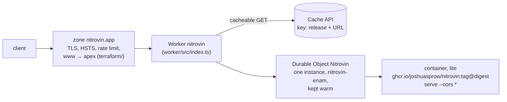

# nitrovin.app on Cloudflare

`https://nitrovin.app` runs the released image's `nitrovin serve`: the page
at `/`, which decodes and translates, with the browser's Service Worker at
`/sw.js` (ADR 0013), the `/v1` API and MCP over Streamable HTTP at `/mcp`
([#104](https://github.com/joshuasprow/nitrovin/issues/104),
[#175](https://github.com/joshuasprow/nitrovin/issues/175)).



| Piece | Where | Applied by |
| --- | --- | --- |
| Worker, Durable Object, container, keep-warm cron | `worker/` (`wrangler.jsonc`, `src/index.ts`, `Dockerfile`) | `wrangler deploy` in `deploy.yml` |
| Zone settings (Full strict, always HTTPS, TLS ≥ 1.2, HSTS, Web Analytics off), the custom domain, `www` and its redirect, the rate limit | `terraform/` | `terraform apply` in `deploy.yml` |
| The CI token, the state bucket and its R2 token | `terraform/token/` | a person, at bootstrap |

- **Image.** Containers cannot pull from ghcr.io, so `worker/Dockerfile` is
  `FROM ghcr.io/joshuasprow/nitrovin:<tag>@<digest>` plus the command, and
  `wrangler deploy` pushes it to Cloudflare's registry. `deploy.yml` rewrites
  the `FROM` line to the release it deploys after `cosign verify` proves the
  digest is the one that tag's `release.yml` signed.
- **Container.** The `default` scheduling policy, `lite` (1/16 vCPU,
  256 MiB), `max_instances: 3`, placed in the US only (`regions` ENAM and
  WNAM, `jurisdiction: "us"`, [#124](https://github.com/joshuasprow/nitrovin/issues/124)).
  Every request goes to one named instance, through its Durable Object
  `nitrovin-enam`, created with `locationHint: "enam"`: the object never
  moves after it is created, and each container round trip passes through
  it ([#126](https://github.com/joshuasprow/nitrovin/issues/126)). A new
  place needs a new name. A cron fetches `/healthz` every four minutes,
  inside `sleepAfter`'s ten, so it never sleeps. Readiness is `/healthz`:
  `serve` listens only once the data has loaded.
- **Cache.** `GET /v1/decode/*`, `GET /v1/info` and the release's assets,
  `GET /ui/r/<release>/…` (the pages' scripts and stylesheet, the Service
  Worker's `sw.wasm`, the spine bundle, the server's files and EPA's), are
  served from the Cache API under a key of the release and the URL. The release
  (`decoder_version/data_month/artifact_hash`) is the Worker's `RELEASE`,
  which `deploy.yml` reads from the image it deploys, so a hit never
  reaches the container and a new data month is a new key, never last
  month's answer. A miss is stored only when the container answered 200
  and its own `/v1/info` is that release: during a rollout the old
  container's answers pass through uncached (`BYPASS`). Each Worker
  isolate asks `/v1/info` on its misses only until it once answers the
  release, which then holds for the deploy. Cached answers carry
  `Cf-Cache-Status` (`MISS`, `HIT`, `BYPASS`) and `Cache-Control: public,
  max-age=86400`, except the assets, which keep the container's
  `public, max-age=31536000, immutable`: their URL names the release, so a
  new release is a new URL (ADR 0013). Everything else, refusals included,
  is `no-store`, but `/sw.js`, which keeps its `no-cache` so a browser
  asks for it on every update check; `POST` and `/mcp` never touch the
  cache. The pages are not cached: one URL answers a fragment for htmx
  and a whole page otherwise. The Cache API is each data center's own,
  and two connections from one client can end in two, so `smoke.sh` asks
  for a URL twice over one connection, and reads a second `MISS` as a
  broken cache only when both answers' `cf-ray` name one data center
  ([#131](https://github.com/joshuasprow/nitrovin/issues/131)).
- **CORS** is the container's (`serve --cors '*'`): `/v1` and `/mcp` only.
- **Logs.** Workers Logs without invocation logs, which would record each
  URL and so each VIN. The Worker logs nothing itself.
- **Web Analytics** is off for the zone: on, Cloudflare injects its beacon
  script into every page, which the pages' CSP refuses and the site's
  promise of no third-party scripts forbids
  ([#192](https://github.com/joshuasprow/nitrovin/issues/192)).
- **Rate limit.** `/v1/decode*` and `/mcp`: 100 requests per 10 s per IP,
  then 10 s refused. The Free plan's one rule.

Cost: Workers Paid $5 a month, one warm `lite` about $1.70; three instances
at most bound it near $12.

## Deploy, roll back

Every green release (`release.yml` on a `v*` tag) deploys itself:
`deploy.yml` resolves and verifies the image, `wrangler deploy`s it
(`--containers-rollout=immediate`), applies Terraform when its plan has
changes (copying the state to `history/main/` in the bucket first: R2
keeps no object versions), waits until the container rollout has finished
(`rollout-wait.sh`: no rollout active and every instance on the
application's image, at most 20 minutes, [#127](https://github.com/joshuasprow/nitrovin/issues/127)),
and runs `smoke.sh` against `https://nitrovin.app`, whose output is the
run's summary. Runs are serialized.

```sh
gh workflow run deploy.yml -R joshuasprow/nitrovin -f tag=v0.1.6   # deploy (or redeploy) a release
gh workflow run deploy.yml -R joshuasprow/nitrovin -f tag=<previous tag>   # roll back, container included
cd deploy/cloudflare/worker && npx wrangler rollback               # roll back the Worker version alone
```

A weekly `drift` job fails when `terraform plan` is not empty.

## Develop

```sh
cd deploy/cloudflare/worker && npm ci && npm run check   # types
deploy/cloudflare/worker/dev-test.sh                     # wrangler dev on this tree's container
```

`dev-test.sh` needs Docker and Go, no account: it builds the Service
Worker's module (`scripts/sw.sh`, as a release does) and two images of this
tree that differ only in `decoder_version`, and serves them in turn under
`wrangler dev` with one persisted cache, running `smoke.sh` against each. A
decode is a `MISS`, then a `HIT`; the second image's first decode of the
same URL is a `MISS` again (the release is in the key), and the first
image's, run again, a `HIT` (the cache did persist). The release's
`sw.wasm` under `/ui/r/` goes the same way, `immutable` throughout, while
the page without JavaScript, its fragment for a VIN and `/sw.js`
(`no-cache`) are never cached. Last, the second image under the first
one's `RELEASE`, a rollout not yet done, is `BYPASS` twice: nothing it
answers is stored. Pull requests touching `deploy/cloudflare` run it, with
Terraform's `validate` and `plan`.

## Bootstrap (once, by hand)

On the Cloudflare account that holds `nitrovin.app` (Josh's own; not the
company's). Secrets go into the repository with `op read … | gh secret set`.

1. **A release with `/mcp` and `--cors`.** The container runs
   `serve --cors '*'`; v0.1.5 and older exit 2 on it. Merge
   [#105](https://github.com/joshuasprow/nitrovin/pull/105) and tag the next
   release.
2. **Workers Paid** on the account (Containers need it), and **R2**
   enabled.
3. **Everything else account-level, by `terraform/token/`**: the state
   bucket `nitrovin-tfstate` (with its 90-day expiry on `history/`), the R2
   token for it (objects in that bucket only; its id is the S3 access key,
   the SHA-256 of its value the secret), and the CI token with exactly the
   scopes in `token/main.tf`. Run it with a short-lived bootstrap API token
   of yours (*Account API Tokens Write*, *Workers R2 Storage Write*, and
   *Zone Read* on `nitrovin.app`). The bucket does not exist before this
   apply, so it runs on local state, which then moves into the bucket:
   ```sh
   cd deploy/cloudflare/terraform/token
   export TF_VAR_account_id=<account id> CLOUDFLARE_API_TOKEN=$(op read 'op://<bootstrap token>')
   printf 'terraform {\n  backend "local" {}\n}\n' >backend_override.tf   # ignored by git
   terraform init && terraform apply

   # The state's credentials: the repository's, and yours (1Password) for later applies here.
   export AWS_ENDPOINT_URL_S3=https://$TF_VAR_account_id.r2.cloudflarestorage.com
   export AWS_ACCESS_KEY_ID=$(terraform output -raw r2_access_key_id) AWS_SECRET_ACCESS_KEY=$(terraform output -raw r2_secret_access_key)
   op item create --category 'API Credential' --title 'nitrovin tfstate (R2)' "username=$AWS_ACCESS_KEY_ID" "credential=$AWS_SECRET_ACCESS_KEY"
   gh secret set R2_ACCESS_KEY_ID -R joshuasprow/nitrovin --body "$AWS_ACCESS_KEY_ID"
   printenv AWS_SECRET_ACCESS_KEY | gh secret set R2_SECRET_ACCESS_KEY -R joshuasprow/nitrovin
   terraform output -raw ci_token | gh secret set CLOUDFLARE_API_TOKEN -R joshuasprow/nitrovin
   gh variable set CLOUDFLARE_ACCOUNT_ID -R joshuasprow/nitrovin --body "$TF_VAR_account_id"

   # Move the state into the bucket; the local copy holds the tokens, so it goes.
   rm backend_override.tf
   terraform init -migrate-state -force-copy && rm -f terraform.tfstate terraform.tfstate.backup
   ```
   Then delete the bootstrap token. A later apply here (a token's scopes)
   is `terraform init` with the R2 credentials from 1Password and a new
   short-lived token; no override.
4. **The first deploy**: `gh workflow run deploy.yml -R joshuasprow/nitrovin -f tag=<release from step 1>`.
   It creates the Worker and its container, then Terraform attaches
   `nitrovin.app` to it.
